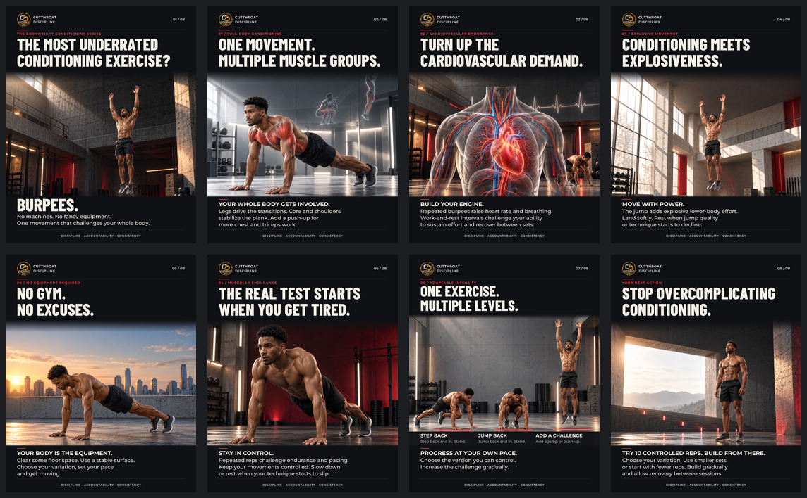

# Burpees — Cut Throat Discipline

Eight cinematic 4:5 slides about burpees and conditioning, with the established logo and **Discipline - Accountability - Consistency** footer.

[Download the posting ZIP](https://github.com/eambrister/Instagram-TikTok-/raw/main/outputs/ctd-burpees/final-carousel.zip) · [Copy the caption](caption.txt) · [Slide transcript](copy.txt) · [Alt text](alt-text.txt)

## Post in this order

1. [The hook](01-hook.png)
2. [Whole-body involvement](02-whole-body.png)
3. [Cardiovascular demand](03-cardiovascular.png)
4. [Explosive movement](04-explosiveness.png)
5. [No equipment](05-no-equipment.png)
6. [Muscular endurance](06-endurance.png)
7. [Scalable variations](07-progression.png)
8. [Your next action](08-start.png)

Save the eight numbered PNGs to your device. In Instagram, create a post, choose multiple photos in this order, and use the portrait crop. Check that each slide's edges are visible before adding the caption. The overview preview is for review; post the individual slides. Optional accessibility descriptions are provided in `alt-text.txt`.

## Production files

The PNGs are ready to post at 1080 × 1350 px. Each SVG embeds its background, logo and open fonts. To edit with a desktop SVG application, install the three fonts from [`../../brand/fonts`](../../brand/fonts) if your editor does not load embedded fonts.

The requested Heading Now and Gotham files are not installed. This edition uses Barlow Condensed ExtraBold and Montserrat Medium/Bold as temporary substitutes. Fonts and their licenses are included in the repository.

Generated scenes are illustrations of a consistent fictional athlete. They are not photographs of Edison or measured anatomy scans. The caption's personal progression to 100 uninterrupted burpees was confirmed by Edison.

Rebuild from the repository root with `python tools/build_ctd_burpees.py`. It reads `content.json`, the scene assets and included fonts, then exports eight SVGs, eight PNGs, the preview and a text-bounds validation report. Inkscape, ImageMagick and Python fontTools are required. Copy, caption and posting ZIP are separate final deliverables.
