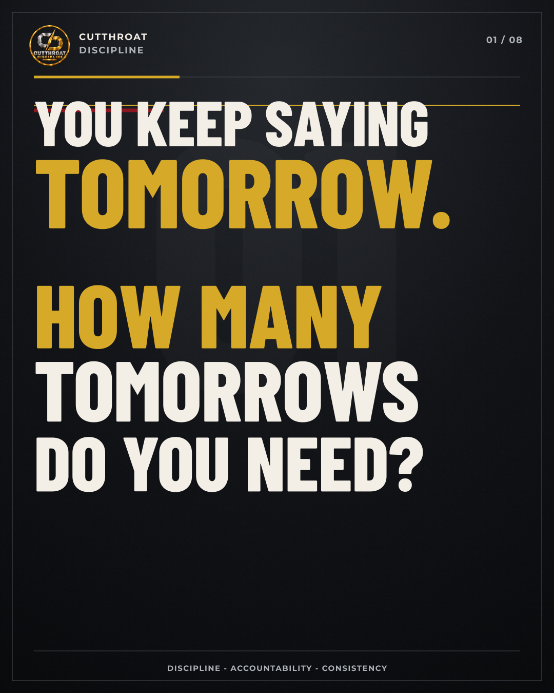

# Talkers vs Doers

An eight-slide, typography-only CUTTHROAT DISCIPLINE carousel confronting procrastination and pushing the reader toward immediate action.

[Download the complete posting package](final-carousel.zip) · [Copy the caption](caption.txt) · [View all eight slides](overview.jpg) · [Read the slide copy](copy.txt)

## Posting order

1. You keep saying tomorrow—how many tomorrows do you need?
2. Talking can feel productive, but it isn't progress
3. Talkers announce; doers execute
4. “I'll start tomorrow” often means avoiding discomfort today
5. Your goal isn't confused; you keep avoiding it
6. Wanting earns nothing; completed work is the receipt
7. Stop announcing the plan; build the evidence
8. Close this post and do one thing right now

Upload the numbered PNG files in order. Every slide is 1080 × 1350 pixels (4:5). `overview.jpg` is a contact sheet for reviewing all eight slides; post the individual PNGs.

The carousel contains typography, vector geometry, texture, and the supplied CUTTHROAT DISCIPLINE logo. It contains no AI-generated people or fitness imagery.
